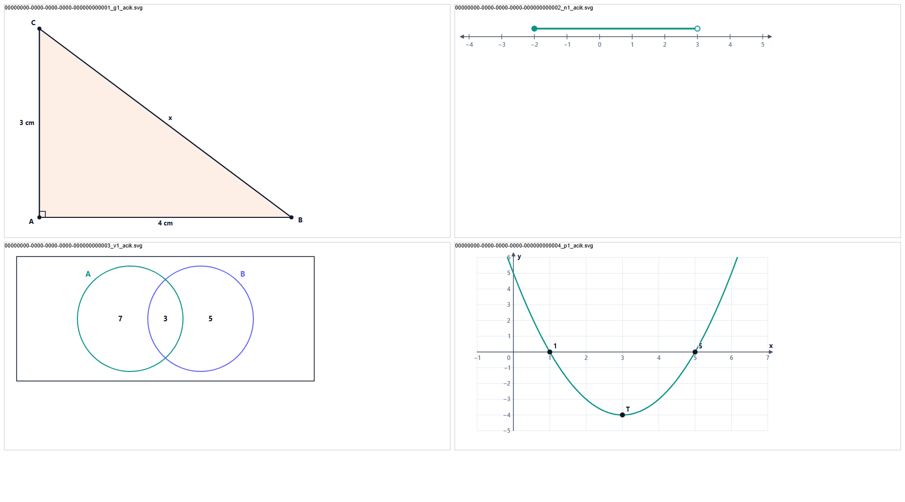

# TYT bitiş raporu ve figür altyapısı istekleri

Kapsam: YKS TYT quiz soruları (10 ders, 10.708 soru) ve AYT/KPSS için figür ihtiyacı (32.829 quiz sorusu).
Revizyon: 6 · 2 Kasım 2026 (geçmiş en sonda).

## İçindekiler

1. [Kısaca](#kısaca)
2. [TYT revizyonu: ders ders](#1-tyt-revizyonu-ders-ders)
3. [Figür sistemi: elde ne var](#2-figür-sistemi-elde-ne-var)
4. [Elde olup kullanılmayanlar](#3-elde-olup-kullanılmayanlar)
5. [Eksikler](#4-eksikler)
6. [AYT ve KPSS figür ihtiyacı](#5-ayt-ve-kpss-figür-ihtiyacı)
7. [Altyapı istekleri (iletilecek bölüm)](#6-altyapı-istekleri)
8. [Sıra ve canlıya yazım durumu](#7-sıra-ve-canlıya-yazım-durumu)
9. [TYT figürlerinin motora taşınması](#8-tyt-figürlerinin-motora-taşınması)
10. [TYT figür turu (R5)](#9-tyt-figür-turu-r5)
11. [Revizyon geçmişi](#revizyon-geçmişi)

## Kısaca

- **Karar (1 Kasım 2026):** figürlerin tek çizicisi motordur. Ayrıntı API'deki `docs/works/Motor-Hazir-Resimleri.md` (Rev. 2) belgesinde.
  - Soru figürü motorun görseli olarak yazılır.
  - Motor açık ve koyu tema için SVG üretir.
  - API görseli Works aktarımındaki gibi figüre çevirir ve hazır resmi bağlar; istemci resmi gösterir.
  - C# çizici yalnız mevcut figürler için kalır.
- **TYT revizyonu bitti.** 10 dersin 10.708 quiz sorusu denetimden geçti; her ders yerel deneme veritabanında güncelleme ve geri alma ile birebir doğrulandı.
- **TYT'nin figürleri motora taşındı (bölüm 8).**
  - 142 figürün 139'u motorun görseline çevrildi ve motorun çizicisiyle açık ve koyu temada çizildi.
  - API'nin kendi çeviricisinden geçen veri 123 figürde eskisiyle birebir aynı. 16 figür motorun sınırlarına sığması için elle yazıldı.
  - 3 soru motorun iki serili grafiğini bekliyor (M2.16) ve o gelene kadar canlıya yazılmayacak.
- **Rev. 2'deki isteklerin çoğu karşılandı:** A2 (API), M1 (motor), R1–R3 (revizyon aracı). Kalanlar ve yeniler bölüm 6'da durumlarıyla:
  - API: A1'in panel kısmı, A3 (panelde hazır resmin korunması), A4 (yanlış alarm).
  - Motor: M2.16–M2.21; içlerinde kalın “D” harfinin bozulması da var.
- **Canlıya hiçbir şey yazılmadı.** Sıra: motor hataları düzelince yeniden çizim, resimlerin depoya yüklenmesi (onay), SQL (onay).

## 1. TYT revizyonu: ders ders

| Ders | Soru | Yanlış anahtar | Birden çok doğru | Kökte olmayan tablo/metin | Canlıdaki figür → revizyon sonrası |
|---|---:|---:|---:|---:|---:|
| Biyoloji | 645 | 5 | 3 | 59 | 17 → 12 |
| Coğrafya | 1.202 | 1 | 14 | 146 | 25 → 33 |
| Din Kültürü | 1.325 | 0 | 0 | 134 | 0 → 0 |
| Felsefe | 785 | 3 | 5 | 168 | 0 → 0 |
| Fizik | 815 | 30 | 0 | 56 | 64 → 8 |
| Geometri | 1.385 | 268 | 2 | 66 | 2 → 10 |
| Kimya | 605 | 0 | 0 | 39 | 2 → 2 |
| Matematik | 1.425 | 290 | 9 | 303 | 16 → 54 |
| Tarih | 1.382 | 12 | 14 | 133 | 23 → 23 |
| Türkçe | 1.139 | 192 | 163 | 91 | 0 → 0 |
| **Toplam** | **10.708** | **801** | **210** | **1.195** | **149 → 142** |

**Yanlış anahtar**, işaretli cevabın gerçekte yanlış olduğu soruları sayar. Bu sorularda kök ve şıklar, doğru şık harfi değişmeden yeniden kuruldu. Hiçbir soruda doğru harf değişmedi.

**Kökte olmayan tablo/metin**, kökün “tabloda”, “şekilde” ya da “metinde” dediği ama böyle bir öge bulunmayan soruları sayar. TYT'nin en yaygın hatası buydu.

Öğrencilerin daha önce çözdüğü 88 soru da revize edildi. Harfleri aynı kaldığı için eski cevaplar bozulmuyor.

Ders raporları `Outputs/Quizzes/Results/YKS/YKS_TYT/<DERS>/DersRaporu.md` altında.

> **Düzeltme notu:** Ders raporlarının hata sınıflandırıcısı (`Tools/lesson_report.py`) “İşaretli cevap yanlıştı” ifadesini tanımıyordu. Python'da “İ” küçültülünce noktalı “i̇” oluşuyor ve eşleşme kaçıyordu. MAT raporu 290 yerine 1, GEO raporu 268 yerine 3 yanlış anahtar gösteriyordu. Sınıflandırıcı düzeltildi, 10 ders raporu yeniden üretildi ve raporlara “Konu içinde tekrar eden kurgu” satırı eklendi.

### Revizyonda kullanılan figürler

| Tür | Adet | Nerede |
|---|---:|---|
| Tablo (1) | 82 | MAT 41, TAR 15, COG 11, GEO 10, FIZ 5 |
| Grafik (2): sütun ve çizgi | 13 | MAT (veri-istatistik) |
| Zaman çizelgesi (11) | 7 | TAR |
| İklim grafiği (10) | 6 | COG |
| Nüfus piramidi (30) | 5 | COG |
| Fonksiyon grafiği (6) | 3 | FIZ |
| Eş yükselti eğrileri (43) | 3 | COG |
| Eski figürü korunan soru | 23 | BIO 12, COG 8, KIM 2, TAR 1 |

**Fizikteki düşüş (64 → 8):** Fizikte aynı kurguyu tekrar eden 56 soru, farklı kazanımlara göre yeniden yazıldı. Bunlardaki figürler kalktı: 15 fonksiyon grafiği, 34 tablo, 6 diyagram ve 1 grafik. Sorular figürsüz hâlleriyle doğru ve geçerli, ama fizik görsel olarak zayıfladı. Bölüm 7'deki TYT figür turu bunu da kapsıyor.

## 2. Figür sistemi: elde ne var

Uygulamada figürler üç yoldan çiziliyor:

| Kim çizer | Türler | Not |
|---|---|---|
| İstemci (web ve mobil) | Tablo, Grafik (sütun, çizgi, pasta), Diyagram, Ağaç, Karşılaştırma, Cümle, Paragraf, Formül, Denklem, Akış, Kavram haritası (0–4, 13–19) | Veriden doğrudan çizilir. |
| Sunucu (C# SVG, **donduruldu**) | Harita, Fonksiyon grafiği, Geometri, Sayı doğrusu, Soy ağacı, İklim, Zaman çizelgesi, Venn, Kuvvetler, Dinamik, Atom, Molekül, Katı cisim, Devre, Optik, Vektör, Dalga, Hücre, Punnett ve diğerleri (5–12, 20–57) | Mobil bunları `isServerDrawn` bayrağıyla tanır, yeni tür için uygulama güncellemesi gerekmez. |
| Video motoru | 120 görsel türü (`sinavika_video_engine/src/Components/Visuals/VisualSchema.ts:65`) | API bunların 64'ünü C# türlerine çevirir (`ContentFigureVideoEngineConverter.cs`). Kalan 56 tür Motor görseli (58) olarak saklanır ve yalnız hazır resimle gösterilir. |

**Hazır resim (still) altyapısı yarı kurulu:**
- Soru figürleri tablosunda (`QuestionFigures`) `StillLightUrl`, `StillDarkUrl`, `StillWidth` ve `StillHeight` sütunları var (mig127, canlıda).
- Quiz yolu (`QuizService` → `ContentFigureMapper.ToDtos`) hazır resmi istemciye gönderiyor. Web ve mobil, hazır resmi olan figürde resmi gösteriyor.
- Eksik olanlar bölüm 6'daki A1 ve M1 istekleri.

### Bu oturumda yapılan çizim testi

Matematikte en çok gereken dört türü FigureCheck aracıyla gerçek C# çizicide çizdirdim. Dördü de hatasız geçti, açık ve koyu temada SVG üretti:

1. **Geometri:** A noktasında dik açılı ABC üçgeni, kenarlarında “3 cm”, “4 cm” ve “x” etiketi.
2. **Sayı doğrusu:** [−2, 3) aralığı; dolu ve boş uç doğru.
3. **Venn şeması:** iki küme, bölgelerde 7 / 3 / 5.
4. **Fonksiyon grafiği:** x² − 6x + 5; köklerde 1 ve 5, tepe noktasında T işareti.

Çizim kalitesi soru için yeterli. Küçük kusurlar:
- Fonksiyon grafiğinde nokta etiketi “1”, eksen sayısı “1” ile çakışıyor.
- y ekseninin en üst sayısı eğrinin altında kalıyor.
- Venn şemasında evrensel küme harfi (E) yok.

## 3. Elde olup kullanılmayanlar

Revize TYT köklerinde, figürü olmayıp çizimle sorulmaya uygun soruların sayısı aşağıda. Sayılar anahtar kelimeyle bulundu ve üst sınırdır, her biri çizim istemez. Örneğin “üçgenin iç açıları toplamı” sorusu sözel de doğrudur.

| Ders | Konu | Figürsüz kök | Kullanılabilecek tür (C# / motor) |
|---|---|---:|---|
| Geometri | Üçgen, dörtgen, çokgen | 1.033 | Geometri (7) / `geometry` |
| Geometri | Açı | 404 | Geometri (7) / `geometry.angles` |
| Geometri | Çember ve daire | 95 | Yalnız tam çember (7) / `geometry.circles.arc` ile yay ve dilim |
| Geometri | Katı cisim | 49 | Katı cisim (23) / `solid` |
| Geometri | Analitik | 33 | Geometri (7), Fonksiyon grafiği (6) |
| Fizik | Kuvvet ve denge | 127 | Kuvvetler (20), Dinamik (26) / `lever`, `pulley` |
| Fizik | Optik | 66 | Optik (32) |
| Fizik | Elektrik devresi | 21 | Devre (35) |
| Matematik | Sayı doğrusu ve aralık | 26 | Sayı doğrusu (8) |
| Matematik | Fonksiyon ve parabol | 12 | Fonksiyon grafiği (6) |
| Matematik | Kümeler | 8 | Venn (12) |
| Biyoloji | Hücre, zar, osmoz | 46 | Hücre (48), Zar (49), Osmoz (50) |
| Biyoloji | Kalıtım | 24 | Punnett (55), Soy ağacı (9) |
| Biyoloji | Ekoloji | 12 | Besin ağı (53), Besin piramidi (54) |
| Coğrafya | Harita ve ölçek | 49 | Harita (5), Eş yükselti (43) |
| Kimya | Atom ve periyodik sistem | 23 | Atom (21), Periyodik (C#) / `orbitals` |

**Neden kullanılmadı:** Soru üreticisinde yalnız tablo ve grafik için kısa yardımcılar vardı. Geometri ve sayı doğrusu gibi türler her soruda koordinat ve etiket yazmayı gerektiriyor; bunlar için yardımcı yazılmadı.

Bir ajanın raporundaki “parabol çizen tür yok” yorumu yanlış: Fonksiyon grafiği (6) parabolü kökleri ve tepe noktasıyla çiziyor, test resminde görülüyor.

## 4. Eksikler

### 4.1 Quiz sorusuna motor çizimini taşıyan yol yok (en büyük eksik)

| Parça | Durum | Yer |
|---|---|---|
| Motorun tek görselden açık/koyu hazır resim üretmesi | **Yok.** `docs/works/Motor-Hazir-Resimleri.md` tarif ediyor, motorda yazılmadı. `scripts/RenderStills.ts` yalnız video sahnesinin tam karesini alıyor. 194 Works görseli de bunu bekliyor. | motor |
| Motor görseli (58) soru figürü olarak | **Yok.** `IsImportOnly` (`ContentFigureKindCatalog.cs:75`), yalnız Works içe aktarmasıyla oluşuyor. | API |
| Hazır resmi olmayan 58'in quiz'de gizlenmesi | **Yok.** Works `ToStudentDto` ile gizliyor; quiz `ToDtos` kullanıyor ve 58'i boş gönderir. | API |
| Hazır resmi yükleme ucu | Var: `POST /api/admin/works/stills` (blob adresi döndürür). Adı ve kapsayıcısı Works'e özel. | API |
| Hazır resim sütunları ve istemci gösterimi | Var (mig127, web ve mobil). | — |

Bu yol açılmadan motorun 56 türü (organik yapı formülü, makara, kaldıraç, manyetik alan, nefron, kalp…) hiçbir soruda kullanılamaz. C# türlerinde de yay ve çentik gibi öğeler, C#'ın kendi çiziminde kaybolur.

### 4.2 Motorda da olmayan çizimler

| Alan | Eksik | Motorda bugün |
|---|---|---|
| Geometri | Paralellik oku; çembere teğet doğru (değme noktasında dik işareti); yükseklik, kenarortay ve açıortay için ayak noktasını kendisi bulan kısayol; “ölçekli değildir” işareti | `geometry`: yay, dilim, çentik, açı yayı, taralı çokgen, eksen var |
| Katı cisim | Köşe harfleri, gizli ayrıt kesik, ayrıt ölçü etiketi, kesit düzlemi, kesik koni ve piramit, birleşik cisim | `solid`: temel cisimler ve açınım |
| Fonksiyon grafiği | İki eğri arasında tarama | `plot`: en çok 3 eğri, parçalı tanım, açık/kapalı uç, teğet, limit, tek eğri altı alan, eksen başlığı. Asimptot kesik doğru parçasıyla çizilebiliyor. |
| İstatistik | Pastada dilim değerini “?” bırakma; histogram; nokta grafiği; kutu grafiği; piktogram | `pie`: değer, yüzde ya da açı gösteriyor |
| Matematik | Saat (akrep, yelkovan); bölme şeması (bölünen, bölen, bölüm, kalan; polinom bölmesi) | yok |
| Fizik | Transformatör; devrede voltmetre, sığaç, bobin, diyot, alternatif akım kaynağı, reosta | `circuit`: yalnız direnç, lamba, ampermetre, anahtar |
| Kimya | Manometre, U borusu, musluklu bağlı kaplar | `gas`: yalnız pistonlu kap |
| Biyoloji | Solunum sistemi (akciğer, alveol), kulak, iskelet ve eklem, endokrin bezler, üreme sistemi ve embriyo, bitki dokuları ve çiçek, fotosentez (ışığa bağlı ve bağımsız evreler) | Nefron, kalp, sindirim, sinir hücresi, göz, sarkomer ve protein sentezi var. Fotosentez yalnız karbon döngüsünün bir aşaması. |
| Coğrafya | Harita ölçeği (çizgisel ve kesir) | `map`: işaret, bölge, gölge ve rota var |

### 4.3 İstemci (web ve mobil)

- **Web çizgi grafiği noktaları eğriyle bağlıyor** (`sinavika_frontend_student/src/features/content-figures/components/ContentFigureView.tsx:237`, `type="monotone"`). Çizgi grafiği düz parçalı olmalı; eğri, noktalar arasında olmayan değerler gösteriyor.
- **Mobilde sunucu çizimi sabit 1,6 en-boy kutusunda** (`sinavika_mobile_reactnative/src/shared/components/ui/ContentFigureView.tsx:68`). Sayı doğrusu küçülüyor, uzun üçgen ve koni daralıyor.
- **Web çözüm metninde `{{fig:…}}` işlenmiyor** (`QuizQuestionView.tsx`, `QuizSolutionList` → `renderInlineMarkup`). Revizyonda çözüm metni figür işareti içermiyor, ama ilerisi için not.
- **Pasta grafiğinde değerler hep yazılı** (web dilim etiketi, mobil lejant). Bu eksik istemciye eklenmez, motor yoluyla kapanır (M2).

### 4.4 API denetim boşluğu

`Services/Content/Validation/ContentFigureValidator.cs:23-26`'daki ifadeler kökün bir görsele dayandığını şu sözlerde göremiyor:
- “tabloda”, “tablodaki”, “tabloya göre”
- “şekle göre”
- “grafiğe göre”

“tablo” yalnız “aşağıdaki/verilen tablo” biçiminde yakalanıyor. TYT'deki 1.195 “kökte olmayan tablo/metin” sorusunun önemli bir kısmı bu boşluktan geçmiş olabilir.

### 4.5 Revizyon aracı

`Tools/FigureCheck/Program.cs`'teki `CanlidaEnYuksekTur = 46` eskidi (Rev. 3: düzeltildi, sınır 58). API 31 Ekim'de 47–57 türleriyle canlıya çıktı; sınır 57 olmalı.

## 5. AYT ve KPSS figür ihtiyacı

Canlıdaki AYT ve KPSS quiz sorularının taraması (YDT hariç): 32.829 soru. Bunların 3.694'ünün kökü figürü olmadan bir görsele atıf yapıyor. Atıf sayısı ihtiyacı küçük gösteriyor: TYT'de olduğu gibi çizilmesi gereken pek çok durum kökte sözle anlatılmış.

| Sınav / ders | Soru | Figürlü | Figürsüz atıf | En çok gereken (konu: figürsüz atıf) | Gereken çizim |
|---|---:|---:|---:|---|---|
| AYT Matematik | 2.010 | 40 | 328 | Türev 50, Mutlak değer 28, Parabol 28, Veri-istatistik 26, Eşitsizlikler 42, Üstel 16, İntegral 12, Limit 12, Logaritma 11, Trigonometri 9 | `plot` (var), sayı doğrusu (var), birim çember (var), iki eğri arası alan (M2), histogram ve pasta “?” (M2) |
| AYT Geometri | 965 | 2 | 123 | Ek çizimler 38, Üçgen konuları 35, Analitik 22, Çemberin analitiği 14 | `geometry`: yay, dilim, çentik (var); paralellik, teğet, kısayollar (M2) |
| AYT Fizik | 1.285 | 9 | 88 | Hareket 21, Atışlar 9, Modern fizik 15, Kütle merkezi 6, Vektörler 6, Dalga 5, İndüksiyon 5, Tork 5, Manyetik alan 4 | `projectile`, `kinematics`, `centreOfMass`, `lever`, `pulley`, `circular`, `oscillator`, `magneticField`, `electricField`, `parallelPlates`, `interference`, `bohr`, `photoelectric` (var); transformatör ve devre öğeleri (M2) |
| AYT Kimya | 1.387 | 31 | 107 | Organik kimya 33, Atom ve periyodik 11, Etkileşimler 10, Karbon kimyası 8, Maddenin halleri 7, Asit-baz 6, Modern atom 6 | `molecule` (SMILES yapı formülü), `orbitals`, `energyProfile`, `titration`, `electrochemicalCell`, `phaseDiagram`, `equilibrium`, `gas` (var); manometre ve U borusu (M2) |
| AYT Biyoloji | 925 | 10 | 97 | Solunum 16, Genden proteine 11, Sinir 11, Destek-hareket 10, Komünite 9, Boşaltım 8, Endokrin 7, Sindirim 7 | `nephron`, `circulation`, `neuron`, `digestion`, `geneExpression`, `sarcomere`, `eye` (var); solunum, kulak, iskelet, endokrin, üreme, bitki, fotosentez (M2) |
| AYT Coğrafya (1 ve 2) | 3.730 | 4 | 430 | Kültür bölgeleri, ekosistemler, doğa olayları, nüfus politikaları, ticaret | `map` (dünya ve Türkiye), `climate`, `pyramid`, `contour` (var); harita ölçeği (M2) |
| AYT Tarih (1 ve 2) | 3.270 | 12 | 344 | Dönemlere dağılmış | `map` rota ve bölge, `timeline`, `battle`, `periods` (var) |
| AYT Felsefe, Mantık, Psikoloji, Sosyoloji, Din, Edebiyat | 3.290 | 0 | 330 | Sanat felsefesi 25, Sembolik mantık 9 | Mantıkta `truthTable`, `euler`, `opposition` (var); sanat eserleri için telifsiz resim (Resim (0), yükleme ucu var: `AdminQuestionController.cs:166`) |
| KPSS Geometri (3 düzey) | 2.410 | 28 | 270 | Doğrunun analitiği 100, Üçgen konuları 72, Prizmalar ve piramitler 32, Çokgenler 21 | `geometry`, `solid`; köşe harfi ve kesit (M2) |
| KPSS Matematik (3 düzey) | 3.134 | 28 | 477 | Mutlak değer 116, Eşitsizlikler 77, Fonksiyon 54, Oran-orantı 36 | Sayı doğrusu (var), `plot` (var), tablo (var) |
| KPSS Coğrafya (3 düzey) | 2.181 | 33 | 396 | Yüzey şekilleri 93, Dış ve iç kuvvetler 47, Jeolojik zamanlar 21, Bölgeler 36, İklim 23 | `map` (Türkiye, il ve bölge), `landform`, `contour`, `geotime`, `climate` (var); harita ölçeği (M2) |
| KPSS Tarih (3 düzey) | 3.332 | 98 | 257 | Atatürk ilkeleri, Osmanlı dönemleri, Millî Mücadele | `map`, `timeline`, `battle` (var) |
| KPSS Türkçe ve Vatandaşlık | 4.910 | 0 | 447 | Paragraf 129, Sözel mantık 24, Yargı ve yasama | Tablo (var); devlet örgütü için `hierarchy` ve Ağaç (var) |

Sonuç: AYT ve KPSS'nin figür ihtiyacının büyük kısmı motorda hazır. Bu ihtiyaç A1 ve M1 açılınca karşılanıyor. Motorun eksik listesi (M2) dar ve somut.

## 6. Altyapı istekleri

> Bu bölüm ilgili oturumlara olduğu gibi iletilebilir. Her istekte neden, ne istendiği, nerede yapılacağı ve kabul ölçütü var.
>
> **Ortak ilke (30 Ekim kararı):** C# figür çizicisi donduruldu. Yeni çizimler motorda yapılır ve soruya hazır resim olarak bağlanır. C#'a çizim eklenmez.
>
> **Durum (Rev. 3, 1 Kasım akşamı):**
>
> | İstek | Durum |
> |---|---|
> | A1 | Kısmen yapıldı |
> | A2 | Yapıldı |
> | A3, A4 | Yeni |
> | M1 | Yapıldı |
> | M2.16–M2.21 | Yeni |
> | K1–K3 | Açık |
> | R1–R3 | Yapıldı |
> | R4 | Kural olarak yürürlükte |
> | R5 | Kısmen yapıldı |
>
> Her isteğin altında ayrıntı var.

### API (sinavika)

**A1. Soru figürlerinde motor görseli ve hazır resim**

- *Durum (Rev. 3): kısmen yapıldı.*
  - Öğrenci yolu `ContentFigureMapper.ToDtos` hazır resmi olmayan motor görselini gizliyor; web ve mobil hazır resmi her türde gösteriyor.
  - Revizyon hattı figürü SQL ile yazıyor, resimleri Works'ün yükleme ucuyla (`POST /api/claude/works/stills`) yüklüyor. Ayrı bir uca (madde 3) gerek kalmadı.
  - TYT'nin 139 motor figürünün hepsi API'de bir C# türüne çevriliyor; hiçbiri motor görseli (58) olarak kalmıyor.
  - Açık olanlar: madde 1 (58'in soru kaydında kabulü, AYT ve KPSS'de gerekecek), madde 5 (panel önizlemesi) ve A3.
- *Öncelik:* 1, temel istek. Diğer motor istekleri buna bağlı.
- *Neden:* Motorun 56 türü ve C# türlerinin motordaki zengin hâlleri, ancak hazır resimle quiz ve deneme sorusuna ulaşabilir (bölüm 4.1).
- *İstenen:*
  1. Quiz ve deneme sorusu figürü olarak `Kind = 58` (motor görseli) kabul edilsin. `DataJson` motorun görsel nesnesini (`kind` ve alanları) taşır. Panelde salt okunur gösterim (`IsImportOnly`) kalabilir, ama soru yazma, kaydetme ve SQL ile gelen kayıtlar reddedilmesin.
  2. Öğrenci yolunda hazır resmi olmayan 58 gönderilmesin. Quiz, deneme, çözüm ve inceleme yollarında `ToDtos` yerine `AwaitsStill` süzgeci uygulansın. Böyle bir figüre dayanan soru da öğrenciye sunulmasın: quiz ve deneme seçiminde atlansın, çünkü kökü `{{fig:…}}` ile o figüre dayanıyor.
  3. Hazır resim yükleme ucu soru figürleri için de kullanılabilsin. Ya `POST /api/admin/works/stills` genelleşsin ya da aynı davranışla `POST /api/admin/figures/stills` açılsın; blob adresi, genişlik ve yükseklik döner. Bağlama işini revizyon hattı SQL ile `QuestionFigures` sütunlarına yapar (tek transaction, geri alınabilir), API'de ayrı bağlama ucu gerekmez.
  4. Hazır resim doğrulaması (`figure_still_url_invalid`, `figure_still_size_invalid`) soru figürlerinde de aynı kurallarla çalışsın.
  5. Panelde soru figürünün hazır resmi önizlensin.
- *Kabul:*
  - SQL ile yazılmış 58 figürlü ve hazır resimli bir quiz sorusu web ve mobilde açık ve koyu temada resmiyle görünür.
  - Hazır resmi olmayan aynı soru hiçbir öğrenci yoluna çıkmaz.
  - C# türündeki (örn. Geometri 7) bir figüre hazır resim bağlanınca istemci C# çizimi yerine resmi gösterir.

**A2. Görsel atıf denetiminin genişlemesi**

- *Durum (Rev. 3): yapıldı* (`ContentFigureValidator.QuestionVisualReferenceRegex`). TYT'de 2 yanlış alarm çıktı; ikisinin de kökü yeniden yazıldı (bkz. A4).
- *Öncelik:* 2.
- *Yer:* `Services/Content/Validation/ContentFigureValidator.cs:23-26`.
- *İstenen:*
  - Şu sözler kökün görsele dayandığını göstersin: “tabloda”, “tablodaki”, “tablodan”, “tabloya göre”, “tablosunda”, “grafiğe göre”, “grafikten”, “grafiğinde”, “şekle göre”.
  - “şekilde” yalnız “verilen / yukarıdaki / aşağıdaki / yandaki şekilde” ya da “şekilde verilen / gösterilen / görülen” biçiminde sayılsın. “Bu şekilde” ve “şu şekilde” görsel anlamına gelmez.
  - Denetim yalnız yapay zekâ üretiminde değil, quiz ve deneme sorusu kaydında da çalışsın.
- *Kabul:*
  - “Tabloda verilen değerlere göre…” diyen figürsüz kök reddedilir.
  - “Bu şekilde düşünen biri…” reddedilmez.

**A3. Panelde soru düzenlenince hazır resim korunsun (yeni)**

- *Öncelik:* 1. Motor figürlü sorular canlıya çıkmadan önce gerekli.
- *Neden:* Soru güncellemesi figürleri `ReplaceFiguresAsync` ile baştan yazıyor (`Services/Questions/Services/QuestionService.cs:271`). Works düzenlemesindeki `ContentFigureMapper.KeepStills` burada çağrılmıyor (`WorkAdminService.cs:405`). Panel hazır resmi geri göndermezse, yönetici bir sorunun yalnız kökünü düzeltse bile:
  - C# türündeki figür eski çizime döner;
  - motor görseli (58) öğrenciden gizlenir.
- *İstenen:* Soru ve kitapçık sorusu güncellemesinde `KeepStills(existing.Figures, dto.Figures)` uygulansın. Kodu, türü ve verisi değişmeyen figür resmini korur; verisi değişen figürün resmi düşer.
- *Kabul:* Hazır resimli bir quiz sorusunun yalnız kökü panelden düzeltilince figür resmiyle kalır. Figür verisi değişince resim düşer.

**A4. Görsel atıf kuralının yanlış alarmları (yeni)**

- *Öncelik:* 3.
- *Neden:* Genişletilmiş kural TYT'de iki figürsüz kökü yanlışlıkla görsel atıfı saydı:
  - MAT `0C3F2614`: “bu verilerle hazırlanan sıklık tablosunda”. Sıklık tablosu istatistikte bir kavram; ortada gösterilen tablo yok.
  - FEL `6CE5843A`: “ressamın tablosunda”. Burada tablo resim anlamında.
  İkisi de yeniden yazıldı.
- *İstenen:* “periyodik tabloda” ve “doğruluk tablosunda” gibi “sıklık tablosu” da ayrık tutulsun. Resim anlamı kuralla ayrılamaz; bilgi notu olarak kalsın.

### Video motoru (sinavika_video_engine)

**M1. Tek görselden hazır resim**

- *Durum (Rev. 3): yapıldı* (motor oturumu, 1 Kasım).
  - `npm run figures -- --list` ve `src/Renderers/WorkFigureRenderer.ts` var. SVG'lerde yazılar çizgiye çevrili; 3B görseller WebP.
  - Yazı kesilmesi (kırpma) ve dosya boyutu (`compactSvg`) aynı gün düzeltildi.
  - Soru revizyonu Works'ün ortak manifestine yazmamak için çiziciyi kendi çalıştırıcısıyla kullanıyor (`Tools/RenderFigures.ts`).
- *Öncelik:* 1, A1 ile birlikte.
- *Neden:* Quiz figürleri ve bekleyen 194 Works görseli bu işe bağlı.
- *İstenen:* Girdi olarak `{ id, visual }` satırlarından oluşan bir JSONL alan komut. Her satır için:
  - Görsel tek başına çizilir (sahne çerçevesi olmadan, son kare).
  - Açık ve koyu tema, 1280 px genişlik, saydam zemin, WebP.
  - “Dersler” modülünün renkleri kullanılır.
  - Kurallar `docs/works/Motor-Hazir-Resimleri.md` §2–3'te.
- *Çıktı:* dosyalar ve `{ id, light, dark, width, height }` satırlarından oluşan bir liste. Görsel motor şemasından (zod) geçmezse o satır nedeniyle birlikte hata listesine düşer.
- *Kabul:* Revizyon hattının ürettiği 100 karışık görsel (geometri, plot, molecule, nephron, pulley…) tek komutla iki temada üretilir. Telefon genişliğinde (360 px) yazılar okunur.

**M2. Eksik çizim öğeleri**

- *Öncelik:* 2. Geometri ve istatistik önce, çünkü en çok soru bunlarda.

| # | İstenen | Şema önerisi | İhtiyaç |
|---|---|---|---|
| M2.1 | Paralellik oku | `segments[].parallel: 1\|2` (aynı sayıdaki kenarlara aynı ok) | Geometri tüm sınavlar |
| M2.2 | Çembere teğet | `tangents[]: { circle, at, length }`, değme noktasında dik işareti | AYT Geometri, TYT çember |
| M2.3 | Yükseklik, kenarortay, açıortay kısayolu | `cevians[]: { from, to: "height"\|"median"\|"bisector", label }`, ayak noktası kendiliğinden | Üçgen konuları |
| M2.4 | “Ölçekli değildir” işareti | `toScale: false` küçük not | Geometri |
| M2.5 | Katı cisimde köşe harfi, gizli ayrıt, ayrıt ölçüsü, kesit, kesik koni/piramit, birleşik cisim | `solid.labels`, `hiddenDashed`, `edgeLabels`, `section`, `frustum`, `compose` | TYT, AYT, KPSS katı cisimler |
| M2.6 | İki eğri arası tarama | `plot.area: { between: [f, g], from, to }` | AYT integral |
| M2.7 | Pastada “?” dilim | `pie.masked: [index]` (dilim çizilir, değer yerine “?”) | Veri-istatistik |
| M2.8 | Histogram, nokta grafiği, kutu grafiği, piktogram | `plot` ya da `structure` altında yeni türler | Veri-istatistik, KPSS problemler |
| M2.9 | Saat | `clock: { hour, minute, labels }` | TYT/KPSS problemler |
| M2.10 | Bölme şeması | `division: { dividend, divisor, quotient, remainder, polynomial }` | Bölme-bölünebilme, polinomlar |
| M2.11 | Transformatör ve devre öğeleri | `circuit.items`: `voltmeter`, `capacitor`, `inductor`, `diode`, `acSource`, `rheostat`; ayrı `transformer` | AYT fizik elektrik |
| M2.12 | Manometre, U borusu, musluklu bağlı kaplar | `gas` genişlemesi | AYT kimya gazlar |
| M2.13 | Biyoloji şemaları | solunum (akciğer, alveol), kulak, iskelet ve eklem, endokrin bezler, üreme ve embriyo, bitki dokuları ve çiçek, fotosentez evreleri | AYT biyoloji |
| M2.14 | Etiketli şema kuralı (tüm anatomi türleri) | parçayı harf/rakamla işaretleme, birini vurgulama, adını gizleme (hücrede `numbered` ve `hide` var) | “I numaralı yapı hangisidir?” tipi sorular |
| M2.15 | Harita ölçeği | `map.scale: { kind: "line"\|"ratio", value }` | Coğrafya |
| M2.16 | Çok serili grafik (yeni): 2–4 seri, lejant, sütunlar yan yana | `plot.series` dizi olabilsin ya da yeni `chart` türü | TYT'de 3 soru bunu bekliyor: MAT `9329F9D0`, `38F6126E`; COG `FC4F5C7F` |
| M2.17 | Kalın “D” harfi bozuk çiziliyor (yeni, hata): iç boşluk dolu | `compactSvg` sonrası (18:35 çizimleri düzgündü) | Bütün figürler |
| M2.18 | Kavram haritasının son karesinde kartlar merkezi örtüyor (yeni, hata) | `conceptMap` yerleşimi | BIO `EAF42564` |
| M2.19 | `plot` x ekseni (yeni, hata): uzun sütun etiketi komşusuna yapışıyor (“ÇarşambaPerşembe”); etiketli seride sayısal “0” ve son değer de yazılıyor; 7 noktalı **çizgi serisinde etiketler atlanıyor** (yalnız Salı, Perş, Cmt) ve soru cevaplanamıyor | Etiketli seride her nokta kendi etiketini alsın, sayısal x yazılmasın; etiket sığmazsa iki satıra kırılsın ya da küçülsün | MAT `5202542B`, `4E6D4317`, `87AF2418`, `801B651D`; COG `0D73C534` |
| M2.20 | Eksen sayıları küçük: 1280 px'de yaklaşık 20 px (yeni) | En az genişliğin 1/45'i (28 px) | Bütün grafikler |
| M2.21 | Soru figürleri için dar sınırlar (yeni, bilgi) | `periods`: en çok 4 işaret, en az 2 dönem. `table`: 6 sütun, 8 satır, hücre 40 karakter. TYT'de çevrilerek çözüldü. | Tarih, uzun tablolar |
| M2.22 | Koyu temada harita etiketleri siyah lekeye dönüyor (yeni, hata) | Yazının hâlesi çizgiye çevrilirken dolu şekil oluyor; M2.17 ile aynı kökten gelebilir | COG izohips (3 figür) |
| M2.23 | `timeline`'da yakın yılların etiketleri üst üste biniyor (yeni, hata) | Yakın olaylar farklı kademelere dağıtılsın | TAR `3115F8BE`, `A0F9F89C` |
| M2.25 | `solid` hazır resminde videonun aşama çubuğu ve cismin adı kalıyor (yeni, hata) | "1. Cisim / 2. Ölçüler", altta "Dik koni". Sözleşme §2'ye aykırı; ad bazı soruların cevabını verir. | TYT katı cisim (28 figür), Works |
| M2.26 | `map` dünya tabanı `focus`/`highlights` ile yakınlaştırılınca resimde sol üstte küçülüyor (yeni, hata) | — | TAR `1938B484`, `4CB9BDAE` figürsüz kaldı |
| M2.27 | `landform` `numbered: true`: kıyıda I ile II aynı noktayı gösteriyor; buzulda I yok, adlar yazıyor (yeni, hata) | — | COG `969A1627`, `DF3C016A` figürsüz kaldı |
| M2.28 | `foodweb`: düzey atlayan ok aradaki kutunun arkasından geçiyor (yeni, hata) | — | BIO `DAA6A4EA` figürsüz kaldı |
| M2.29 | `membrane` `numbered: true` iken taşıma türleri adıyla yazılıyor (yeni, hata) | — | Numaralı zar soruları |
| M2.30 | `charges`: elektroskop topuzunun tepesindeki yük işareti çizim alanından taşıyor (yeni, küçük hata) | — | FIZ elektrostatik (7 figür) |

M2.25–M2.30 motor oturumu tarafından 1 Kasım gecesi düzeltildi:
- katı cisimde aşama çubuğu ve ad yok;
- odaklı harita resmi dolduruyor;
- numaralı kıyı ve buzul sahneleri düzeldi;
- besin ağı oku kutunun yanından dolaşıyor;
- numaralı zar düzeldi;
- elektroskop işareti tam görünüyor.

TYT figürleri bu düzeltmelerle yeniden çizildi.
| M2.24 | `geometry`'de kenarın tamamının ölçüsü (yeni, R5) | Üstünde adlı nokta (D, E) olan kenarın tamamının etiketi motorca bir parçanın yanına düşüyor ve o parçanın ölçüsü gibi okunuyor. Kenarın dışında ölçü çizgisi (`segments[].dimension: true`) gerekli. TYT'de parçalar etiketlenerek ya da etiket kökte bırakılarak çözüldü. | Geometri tüm sınavlar |

- *Kabul:* Her öğe M1 komutuyla iki temada çizilir ve şeması belgelenir (motor şeması ve `docs/works` notu).
- *Durum (Rev. 3):* M2.17–M2.23 motor oturumuna iletildi (görüntüler `Outputs/Quizzes/Work/Review/` altında) ve aynı akşam düzeltildi.
  - M2.17: sıkıştırmada eksi işareti kayboluyordu.
  - M2.18: kavram haritası yerleşimi yenilendi.
  - M2.19: etiketli seride her nokta etiketini alıyor, sığmayan etiket kırılıyor.
  - M2.22: koyu temada doğa zeminli etiketler düzeldi.
  - M2.23: zaman çizelgesinde ikinci etiket sırası açıldı.
  - M2.20 kısmen: kutu 860'a indi, yazı yaklaşık %15 büyüdü, plot eksen sayıları 32 px.
  - **Açık kalan:** sahne görsellerinde (harita, iklim, piramit, izohips, süreç…) yazı 12–27 px; telefonda küçük. Görsel bazında ayrı bir iş.
  - TYT figürleri bu düzeltmelerle `render_figures.py <ders> --force` ile yeniden çizilecek.

### İstemciler (web ve mobil)

| # | İstenen | Yer | Öncelik |
|---|---|---|---|
| K1 | Çizgi grafiği düz parçalı çizilsin (`type="linear"`) | web `ContentFigureView.tsx:237` | 2 (hata) |
| K2 | Sunucu çizimi kendi en-boy oranıyla gösterilsin (SVG `viewBox` ya da API'nin vereceği oran); hazır resimde `width/height` zaten var | mobil `ContentFigureView.tsx:68` | 2 |
| K3 | Çözüm metninde `{{fig:…}}` figüre dönsün ya da hiç görünmesin | web `QuizQuestionView.tsx` (`QuizSolutionList`) | 3 |

### Revizyon aracı (bu oturum)

- **R1. Yapıldı.** FigureCheck'in tür sınırı 58.
- **R2. Yapıldı.**
  - Revizyon kaydında figür motorun görseli olarak yazılır: `{"code","title","alt","visual"}`.
  - `Tools/figure_to_visual.py` eski C# figürünü motor görseline çevirir.
  - C# biçiminde yeni figür artık denetimden geçmez.
- **R3. Yapıldı.**
  - `check_revisions.py` görseli API'nin `ContentFigureVideoEngineConverter`'ı ile figüre çevirir (FigureCheck). Hazır resmi olmayan ya da görseli resminden sonra değişen figürün sorusunu dışarıda bırakır.
  - `build_sql.py` hazır resim sütunlarını yazar ve yüklenecek dosyaları `yuklenecek-resimler.json`'a koyar. Silinecek eski figürün hazır resmi varsa SQL durur.
  - `dry_run_sql.py` bu durmayı da dener.
- **R4. Kural olarak yürürlükte.** AYT ve KPSS figürden taviz vermeden yazılır:
  - Çizim gereken soru figürle yazılır.
  - Gereken öğe motorda yoksa soru sözele çevrilmez; M2 listesine işlenir (kayıtta `motorIstegi`) ve o öğe gelene kadar canlıya yazılmaz.
- **R5. Kısmen yapıldı.**
  - TYT'nin figürleri motora taşındı (bölüm 8).
  - Kalan: Geometri, Fizik (figürü kalkan 56 soru dahil), Matematik ve Biyoloji'de çizimle sorulması doğal sorulara figür eklemek. Kimlikler ve doğru harf korunur.

## 7. Sıra ve canlıya yazım durumu

**TYT'nin canlıya çıkış sırası (Rev. 3):**
1. **Motor hataları:** M2.17–M2.30 düzeltildi (1 Kasım akşamı ve gecesi). Açık kalan tek konu sahne görsellerinin küçük yazısı (M2.20). R5 figür turu bitti; TYT'nin 583 figürü yeniden çizildi.
2. **Yeniden çizim:** her ders için `render_figures.py <ders> --force` ve gözle kontrol.
3. **Yeniden üretim ve deneme:** her ders için `check_revisions.py`, `build_sql.py`, `dry_run_sql.py`.
4. **API'de A3:** panelde hazır resmin korunması. TYT'nin 583 figürünün hepsi API'de bir C# türüne çevriliyor, hiçbiri motor görseli (58) değil. Panelden düzenlenen bir soruda resim düşerse figür gizlenmez, aynı veriyle C# çizimine döner. Bu yüzden A3 TYT'nin çıkışını engellemez; görünümün korunması için yapılmalı.
5. **Resim yükleme (onay):** her ders için `upload_stills.py <ders> --yukle`, ardından `--var-mi`. Uç `POST /api/claude/works/stills` canlıda olmalı ve SVG kabul etmeli. Yükleme aynı içeriği aynı adrese yazar; yarım kalırsa tekrar çalıştırılır.
6. **SQL (onay):** her dersin `guncelle.sql`'i, `apply_sql.py <ders> --canli` ile.
   - Tek transaction; kök değişmişse ya da silinecek eski figürün hazır resmi varsa durur.
   - `geri_al.sql` ilk hâle döndürür.

SQL'ler `Outputs/Quizzes/Results/YKS/YKS_TYT/<DERS>/` altında. Yüklenecek resimlerin listesi aynı klasörde `yuklenecek-resimler.json`.

**Sıra şart:** Resimler yüklenmeden SQL çalışırsa figürlerin hazır resim adresi depoda bulunmaz ve uygulama kırık resim gösterir. Eski çizime dönüş yalnız hazır resim sütunları boşken olur. Rev. 4'te yazılan "figür eski çizimle gösterilir" cümlesi yanlıştı.

Motoru bekleyen 4 soru SQL'e girmez: üçü çok serili grafik (M2.16), biri küre kesiti. Bu sorular canlıdaki eski hâlleriyle kalır.

**Canlı durum (1 Kasım gecesi, sahibinin onayıyla):**
- **Canlıda:** Türkçe 1.139, Din 1.325, Felsefe 785 soru; toplam 3.249. Bu derslerde figür yok, resim yüklemesi de gerekmiyordu.
  - Uygulama aracı `Tools/apply_sql.py --canli`; uygulamadan sonra canlıdan geri okuyup doğruluyor.
  - Kök, şık, çözüm ve 955 işaretleme beklenenle birebir aynı.
- **İlk deneme durdu.** Türkçe'nin ilk denemesi canlıdaki `QuestionMarkupSpans (QuestionId, SpanId)` tekil dizinine takıldı: işaret kimliği her bölümde yeniden "u1"den başlıyordu.
  - Transaction bütünüyle geri alındı; canlıda hiçbir şey değişmediği doğrulandı.
  - Düzeltme: kimlik artık soru içinde sıralı. LocalDB denemesi canlının tekil dizinlerini de kuruyor: işaretleme (soru, işaret kimliği) ve figür (soru, kod).
  - Uygulamadan önce canlıda kökü değişmiş soru olmadığı da salt okunur denetimle doğrulandı: 10.704 sorunun hepsi dışa aktarılan hâlinde.
- **Bekleyen 7 ders** (Biyoloji, Coğrafya, Fizik, Geometri, Kimya, Matematik, Tarih):
  - Canlı API hazır resim ucunda SVG kabul etmiyor ("Desteklenmeyen dosya türü"); hiçbir dosya yüklenmedi.
  - SVG kabulü API kodunda var (`Services/Works/Helpers/WorkStillSvg.cs`, 1 Kasım 22:26 commit'i) ama yayınlanmamış.
  - API yayınlanınca sıra: önce `upload_stills.py --yukle` ve `--var-mi`, sonra `apply_sql.py --canli`.
  - **Yayından sonra da ret (A5, yeni, API hatası):** sahip API'yi yayınladı, yükleme yine reddedildi. Neden:
    - `WorkStillService` SVG'yi denetleyip doğru tanıyor, ama yüklemeyi genel `FileService.UploadFileAsync` ile yapıyor.
    - O yol her dosyayı `FileUploadGuard`'ın genel izin listesinden geçiriyor ve listede SVG yok (FileService.cs:62, FileUploadGuard.cs:57).
    - Servis testi `IFileService`'i taklit ettiği için yakalanmamış.
    - İstek: denetlenmiş içerik için ayrı bir yükleme yolu (yalnız hazır resimler için) ve gerçek `FileService` ile test. API oturumuna iletildi.
    - Düzeltme yayınlanınca sıra aynı.
- **TYT'nin tamamı canlıda (2 Kasım 2026, 00:15–00:45):**
  - API'nin SVG düzeltmesi 00:12'de yayınlandı. İlk iki deneme yayın geçişine denk geldi (gövdesiz 500, App Service günlüğüyle doğrulandı); 00:15'ten sonra her yükleme geçti.
  - **Resimler:** 1.148 hazır resim yüklendi (1.092 SVG, 56 WebP, 35,4 MB). Dönen her adres SQL'dekiyle aynı; hepsinin depoda bulunduğu ayrıca denetlendi.
  - **Ön denetim:** SQL'den hemen önce canlıda kök, figür sayısı ve hazır resimli eski figür değişmemişti.
  - **Figürlü dersler:** Kimya 605, Biyoloji 645, Tarih 1.382, Fizik 815, Matematik 1.423, Coğrafya 1.201, Geometri 1.384 soru. Her ders uygulandıktan sonra canlıdan geri okundu: kök, şık, çözüm, işaretleme, figür türü ve hazır resim adresi; hepsi 0 fark.
  - **Toplam:** Türkçe, Din ve Felsefe ile birlikte 10.704 soru ve 583 motor figürü canlıda.
  - **Canlıya girmeyen 4 soru** (motorIstegi) eski hâlinde: üçü çok serili grafik, biri küre kesiti.

**AYT ve KPSS:** başlanmadı. R4 kuralıyla, figürler en baştan motorun görseli olarak yazılacak. YDT atlandı.

## 8. TYT figürlerinin motora taşınması

1 Kasım akşamı, motorun tek çizici olması kararından sonra yapıldı. Taşımadan önceki revizyonların yedeği `Outputs/Quizzes/Work/Backups/2026-11-01-before-engine-figures/` altında.

**Hat:**
1. Revizyon kaydında figür motorun görseli olarak yazılır. Eski figürler `Tools/figure_to_visual.py` ile çevrildi; korunan 22 eski figür de taşındı.
2. `check_revisions.py` görselleri motorun şemasıyla listeler. `render_figures.py` bunları motorun çizicisiyle (`Tools/RenderFigures.ts` → `WorkFigureRenderer`) açık ve koyu tema SVG olarak çizer, `stills.json`'a yazar.
3. `check_revisions.py` yeniden çalışır. FigureCheck görseli API'nin Works aktarımındaki çeviricisiyle figüre çevirir, hazır resmi bağlar ve API'nin kayıt denetiminden geçirir.
4. `build_sql.py` figürü türü, verisi ve hazır resim adresleriyle yazar. Adres, dosya içeriğinin SHA-256 özetidir: `https://sinavikablobsgwc.blob.core.windows.net/work-figure-stills/<sha256>.svg` (taban `paths.py` `STILL_BASE_URL`; 4 Kasım 2026'dan beri Frankfurt hesabı).

**Tür eşlemesi (139 figür):**

| Eski tür | Adet | Motor görseli | API'de saklanan tür |
|---|---:|---|---|
| Tablo (1) | 97 | `table` | Tablo (1) |
| Grafik (2) | 14 | `plot` (sütun ya da çizgi serisi) | Plot (6) |
| Plot (6) | 4 | `plot` (2'si fonksiyon olarak: `2·sin(πx/2)`, `3·sin(5πx)`) | Plot (6) |
| İklim (10) | 7 | `climate` | İklim (10) |
| Zaman çizelgesi (11) | 7 | `timeline` | Zaman çizelgesi (11) |
| Nüfus piramidi (30) | 5 | `pyramid` | Nüfus piramidi (30) |
| İzohips (43) | 3 | `contour` | İzohips (43) |
| Harita (5) | 1 | `map` (il haritası, nokta) | Harita (5) |
| Şema (3) | 1 | `conceptMap` | Kavram haritası (19) |

Hiçbiri motor görseli (58) olarak kalmıyor. Resim yüklenmese bile figür boş görünmez, eski çizimle gösterilir.

**Doğrulama:**
- API'nin çeviricisinden geri dönen veri 123 figürde eskisiyle birebir aynı: tablo hücreleri, iklim değerleri, piramitler, olay yılları, grafik değerleri, harita noktası.
- Elle yazılan 16 figür tek tek gözden geçirildi.

**Elle yazılan 16 figür:**
- **10 tablo:** başlık 30, hücre 40 karakter sınırına sığması için kısaltıldı. Anlam, şıklar ve çözüm korundu. Örnekler:
  - “Miladi takvim ve uluslararası saatin kabulü” → “Miladi takvim ve uluslararası saat”.
  - Amasya Genelgesi maddesi → “Her sancak güvenilir üç delege yollar”.
  - Sayılar çözümdeki gibi Türkçe ondalıkla yazıldı (45,7).
- **3 dönemli zaman çizelgesi:** dönem çubukları başa geçiş ve ölüm olayı oldu (“1362 I. Murat başa geçti”). Sorular aynı bilgiyi okuyor; Yavuz sorusunun D şıkkı 1512–1520 aralığını hâlâ okuyabiliyor.
- **1 şema:** kutu-ok şeması kavram haritası oldu. Çözüm A–E harfleriyle andığı için harfler korundu.
- **2 dalga grafiği:** 33 örnek noktası yerine fonksiyon olarak yazıldı.

**Grafiklerde yapılan düzeltmeler:**
- Eksen üst sınırı değerlere yaklaştırıldı (örn. 0–100 yerine 0–60).
- Basınç grafiği 0–1200 yerine 1005–1020 hPa çizildi. Aksi hâlde aylar arası fark görünmüyordu ve D şıkkı (“basınç yıl boyunca sabit”) çizimden çürütülemiyordu.
- pH grafiği 0–14 aralığına çekildi; etiketlerdeki “Çözeltı” yazım hatası düzeltildi (S1–S5).

**Bekletilen 3 soru (M2.16):** iki serili sütun ve çizgi grafikleri. MAT `9329F9D0` ile `38F6126E`, ayrıca COG `FC4F5C7F` (iki istasyonun 12 aylık sıcaklığı). Kayıtlarında `motorIstegi` var; motor çok serili grafiği çizene kadar SQL'e girmezler.

## 9. TYT figür turu (R5)

1 Kasım gecesi yapıldı. Pilot (Açıortay, 44 figür) ana oturumda yazıldı; geri kalanı ortak bir yönergeyle altı paralel ajana bölündü. Yönerge: `Outputs/Quizzes/Work/TYT-R5/YONERGE.md`. Her konunun betiği, ek dosyası ve ön izlemesi aynı klasörde.

**Ölçüt.** Belirli bir şekil kurgusu anlatan soruya figür eklendi: adlı noktalar, yardımcı doğrular, çember ve teğet, ölçülü katı cisim, koordinatlı nokta, fizik düzeneği, veri grafiği. Kavram, tanım, formül ve özellik sorularına eklenmedi. Ölçekli çizimin cevabı gösterdiği sorulara da eklenmedi; örneğin "ters açılar eşittir" sorusunda eşit açıların çizimi cevabı verir.

**Geometri figürleri ölçekli.**
- Koordinatlar sorunun verisinden ve çözümünden hesaplandı (`Tools/geometry_figures.py`).
- Sayı etiketi çizimle tutmayan figür yazılırken reddedildi (uzunluk %5, açı 2°). FigureCheck de API'nin sessizce "ölçekli değil" yaptığı figürü hata sayıyor.
- Verilen ölçü etiketli, sorulan ölçü etiketsiz; veriler kökte de duruyor.

| Ders | Yeni figür | Figürlü yeniden yazılan soru | Not |
|---|---:|---:|---|
| Geometri | 348 | — | 23 konu; 1 soru motoru bekliyor (küre kesiti) |
| Fizik | 64 (63 soru) | 32 | Figürü kalkan 56 sorudan 32'si figürlü kurguya döndü; 31 soruya figür eklendi |
| Matematik | 14 | — | sayı doğrusu, grafik, Venn |
| Biyoloji | 7 | 3 | soyağacı, besin ağı, numaralı hücre, bölünme |
| Coğrafya | 7 | 5 | Türkiye haritası, iklim, yükselti grafiği, Dünya–Güneş |
| Tarih | 3 | — | harita, zaman çizelgesi |
| Kimya | 1 | — | ısınma grafiği |
| **Toplam** | **444** | **40** | Bölüm 8'in 139 figürüyle TYT'de yaklaşık 583 motor figürü |

- **Kimlik, doğru harf ve şık sayısı** hiçbir soruda değişmedi. Yeniden yazılan sorulardan örnekler ana oturumda bilimsel olarak doğrulandı: elektroskop, dokunma, dalga leğeni, tayga iklimi, mitoz.
- **Ölçekli kurgu üç revize soruda veri çelişkisi buldu.** Üçü de cevap korunarak düzeltildi:
  - GEO `711B05A6`: kenarlar 7 ve 10 yerine 5 ve 8.
  - GEO `C30BF268`: kenar ölçüsü kaldırıldı.
  - GEO `28E428A6`: "[BC]'ye inen" yerine "A köşesinden çizilen yükseklik".
- **Motor hataları yüzünden ertelenip sonra figür gerekmediği görülenler:** TAR `1938B484` ve `4CB9BDAE`, COG `969A1627` ve `DF3C016A`, BIO `DAA6A4EA`.
  - Motor M2.26–M2.28'i aynı gece düzeltti.
  - Sorular yeniden okundu: hepsi öncüllü ya da bilgi sorusu ("yukarıdaki kıyı şekillerinden hangileri…", "Kırım hangisidir?"). Çizim gerekmiyor; Kırım'ı haritada göstermek cevabı verir. Figürsüz kaldılar.
  - Motorun çizemediği 5 katı cisim sorusu (yarım küre, üçgen prizmada ölçü vb.) metinle kurulabildiği için figürsüz kaldı.
- **Son durum (1 Kasım gecesi):**
  - TYT'nin 583 motor figürünün hepsi düzeltilmiş çiziciyle yeniden çizildi.
  - 10 dersin SQL'i LocalDB'de bütün adımlardan geçti: değişmiş kökle durma, hazır resimli eski figürle durma, güncelleme = beklenen, geri alma = ilk hâl.
  - Yüklenecek hazır resim: 1.148 dosya, 35,4 MB. En büyük paylar Coğrafya 12,4 MB ve Geometri 12 MB.
  - Bekleyen: motoru bekleyen 4 soru (3 çok serili grafik, 1 küre kesiti).
- **Açık kalan karar:** Fizik'in elektrostatik, dalga ve ısı konularında figürlü soru oranı hâlâ düşük: 19/150, 10/95, 11/90. Geometride adsız sözel kurgular da (çerçeve, bordür, köşeden kesilen parça) figürsüz. ÖSYM bunları çoğunlukla şekille sorar. Oranı yükseltmek ayrı ve büyük bir yeniden yazım turu gerektirir.

## Revizyon geçmişi

| Rev. | Tarih | Değişiklik |
|---|---|---|
| 1 | 1 Kasım 2026 | TYT bitiş raporu: ders istatistikleri, figür envanteri, çizim testi, eksikler ve öneriler. |
| 2 | 1 Kasım 2026 | Motor envanteri eklendi (120 tür; eksik sanılan çizimlerin çoğu motorda var). AYT ve KPSS figür ihtiyacı tarandı (32.829 soru). Altyapı istekleri eklendi: API A1–A2, motor M1–M2, istemci K1–K3, revizyon aracı R1–R5. İçindekiler ve revizyon geçmişi eklendi. |
| 3 | 1 Kasım 2026 akşamı | Motor tek çizici kararı işlendi. Çalışma motora taşındı (`Curriculum/Quizzes`). TYT'nin 139 figürü motora taşındı ve çizildi (bölüm 8); 3 soru çok serili grafiği bekliyor. İstek durumları güncellendi: A2, M1 ve R1–R3 yapıldı. Yeni istekler: A3, A4 ve M2.16–M2.23. Canlıya çıkış sırası yeniden yazıldı. |
| 4 | 1 Kasım 2026 gecesi | TYT figür turu (R5, bölüm 9): 444 yeni motor figürü, 40 soru figürlü yeniden yazıldı, 3 veri çelişkisi düzeltildi. Motor istekleri M2.24–M2.30 eklendi. M2.17–M2.23'ün düzeltildiği işlendi. |
| 5 | 1 Kasım 2026 gecesi | Canlıya çıkış: Türkçe, Din, Felsefe canlıda (3.249 soru, doğrulandı). İşaret kimliği tekilliği düzeltildi; LocalDB canlının tekil dizinleriyle denenir. 7 figürlü ders API'nin SVG kabulünün yayınını bekliyor. Bölüm 7'deki yanlış cümle düzeltildi. |
| 6 | 2 Kasım 2026 | API'nin SVG düzeltmesi yayınlandı; 1.148 resim yüklendi ve 7 figürlü dersin SQL'i uygulandı. TYT'nin tamamı (10.704 soru, 583 figür) canlıda ve doğrulandı. |
| 7 | 2 Kasım 2026 | Motorun 3B ölçü hatası (yükseklik tepeyi aşıyor, yarıçap orta yüksekliğe kayıyordu) düzeltildi. Geometrideki 28 katı cisim figürü (8 koni, silindir, piramit, küp, prizma, küre) yeniden çizildi. Yalnız hazır resimleri Claude içerik API'siyle güncellendi (`Tools/refresh_stills_api.py`): kuru çalıştırmada her soruda yalnız bir figürün resmi değişti, kök, şık ve çözüm değişmedi. Canlıdan geri okunarak doğrulandı. |
